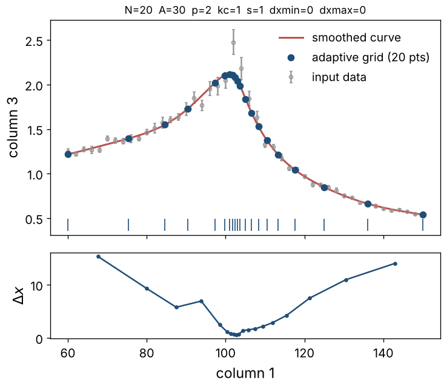

# adaptive_mesh.py

Make a list of x-points that are **close together where your curve changes a lot**
(peaks, steep parts) and **far apart where the curve is flat**.

Typical use: you have a rough curve from a simulation, for example specific heat
vs. temperature from Monte Carlo, and you want to choose temperatures for the
next run. With this tool you spend most of your runs near the peak, where
they are needed, and few runs where nothing happens.

---

## Installation

You need Python 3.8 or newer. Install the three packages it uses:

```bash
pip install -r requirements.txt
```

---

## Quick start

Your data file is a plain text file with numbers in columns. Lines starting
with `#` are ignored.

```bash
python adaptive_mesh.py energy.dat x=1 y=3
```

This means: take x from column 1 and y from column 3, and make 30 new x-points.

You get two files:

| File | What is inside |
|---|---|
| `grid.out` | The new points (see below) |
| `grid.png` | A picture: your data, the smooth curve, the new points, and the distance between neighbouring points (see Figure 1) |

Below is the `grid.out` made by
`python adaptive_mesh.py energy.dat x=1 y=3 err=5 N=20` (the same run as Figure 1):

```
# 20
# 150.00000 135.98206 125.03996 117.56677 113.34544 110.48474 ...
   150.00000   5.386621e-01
   135.98206   6.626481e-01
       ...
```

- Line 1: the total number of points.
- Line 2: all the points in one line, ready to copy into an input file or a loop.
- Points are written from **high to low** by default. Use `order=asc` for low to high.
- After that: one point per line, x in the first column and the smoothed y-value in the second.

The new x-points are also printed on the screen.

### Example picture (`grid.png`)



*Figure 1. 20 points chosen for the Monte Carlo specific heat in `energy.dat`
(`x=1 y=3 err=5 N=20`). The points (blue) crowd around the peak near 102 and are
spread out in the flat tails.*

What you see in the picture:

- **Top panel**
  - Grey circles with error bars: your input data.
  - Red line: the smoothed curve used to choose the points.
  - Blue dots: the new points, drawn on the smoothed curve.
  - Small blue ticks at the bottom: where the new x-points are.
- **Bottom panel**: the distance between neighbouring points (Δx). A low value
  means the points are close together. In Figure 1 the curve dips to about 0.6
  near the peak and rises to about 15 in the flat tails.
- **Title**: the settings used for this run.

---

## How to give arguments

- The first argument is always the **data file**.
- After that, write any settings as `name=value`, in any order.
- Spaces around `=` are fine: `N=20` and `N = 20` both work.
- You only need to give the settings you want to change. All others use
  their default value.

```bash
python adaptive_mesh.py energy.dat x=1 y=3 err=5 N=20 dxmin=1
```

For help on the command line:

```bash
python adaptive_mesh.py -h
```

---

## All arguments, explained simply

### Which columns to read

| Argument | Default | Meaning |
|---|---|---|
| `x` | 1 | The column number of your x-values. The first column is 1, not 0. |
| `y` | 2 | The column number of your y-values (the curve). |
| `err` | 0 | The column number of the error bars of y, if you have them. 0 means "no error column". **If you have error bars, use them.** The tool then trusts accurate points more and noisy points less, and the result is better. The error bars are drawn in grey in Figure 1. |

### How many points

| Argument | Default | Meaning |
|---|---|---|
| `N` | 30 | How many x-points you want in total. Think of it as your budget: how many simulations you can afford. |

### Where the points go

These settings decide **how strongly the points crowd at the peak**.
The easiest way to see their effect is the bottom panel of `grid.png`
(Figure 1). A deeper and narrower dip means more points packed at the peak.

| Argument | Default | Meaning | Bigger number | Smaller number |
|---|---|---|---|---|
| `A` | 30 | **How much more crowded the peak is than the flat parts.** With A=30, points at the peak can be up to about 30 times closer together than in flat parts. | More points at the peak, fewer in flat parts | Points spread more evenly. **A=0 gives equal spacing everywhere.** |
| `p` | 2 | **How narrow the crowded area is.** | The crowd is pulled tightly onto the steepest part | The crowd spreads wider around the peak |
| `kc` | 1 | **Top of the peak or sides of the peak?** The sides of a peak are steep. The very top is flat but bends strongly. This setting decides how much the top counts. | More points on the **top** of the peak (good for finding the exact peak position) | More points on the **steep sides** only |

### Limits on spacing

| Argument | Default | Meaning |
|---|---|---|
| `dxmin` | 0 | **Smallest allowed distance between two points.** Use this if points at the peak come out too close to be useful (e.g. `dxmin=1` means never closer than 1). 0 means no limit. |
| `dxmax` | 0 | **Largest allowed gap between two points.** Use this so flat parts are never left too empty (e.g. `dxmax=5`). 0 means no limit. |

In the bottom panel of Figure 1, `dxmin` raises the bottom of the dip (it can't
go below `dxmin`), and `dxmax` cuts off the high ends (they can't go above
`dxmax`). In Figure 1 neither is set, so Δx goes from about 0.6 to about 15.

The limits must be possible. If you want N points over a range of length L,
the average spacing is L / (N − 1). `dxmin` must be smaller than this average
and `dxmax` must be bigger. If not, the program stops and tells you the
allowed value.

### Smoothing

| Argument | Default | Meaning |
|---|---|---|
| `s` | 1 | **How smooth the curve is made before choosing points.** Real data is noisy. If the tool followed every little jump, it would put points on noise instead of on the real peak. Bigger `s` → smoother curve. Smaller `s` → follows the data more closely, including its noise. Usually leave it at 1. |

In Figure 1 you can see the smoothing at work. The highest data point (about
2.48 near x = 102) has a large error bar, so the red line passes below it and
peaks at about 2.1.

### Range and output

| Argument | Default | Meaning |
|---|---|---|
| `xmin` | lowest x in file | Where the new list of points starts. |
| `xmax` | highest x in file | Where the new list of points ends. |
| `dec` | 5 | How many decimal places the new x-values have (5 → 101.35214, 2 → 101.35). |
| `order` | desc | Order of the points in `grid.out` and on the screen. `desc` = from high to low (e.g. 150 → 60, like cooling in a simulation). `asc` = from low to high. |
| `out` | grid | The name of the output files, without the ending. `out=run2` gives `run2.out` and `run2.png`. |

---

## Examples

```bash
# Simplest: x in column 1, y in column 3
python adaptive_mesh.py energy.dat x=1 y=3

# Also use error bars from column 5 (recommended if you have them)
python adaptive_mesh.py energy.dat x=1 y=3 err=5

# Only 20 points, but pack them even more at the peak
python adaptive_mesh.py energy.dat x=1 y=3 err=5 N=20 A=50 p=3

# Many points at the peak, but never closer than 1 and never further than 5
python adaptive_mesh.py energy.dat x=1 y=3 err=5 dxmin=1 dxmax=5

# Equal spacing (for comparison)
python adaptive_mesh.py energy.dat x=1 y=3 A=0

# Only make points between 80 and 130, save as zoom.out and zoom.png
python adaptive_mesh.py energy.dat x=1 y=3 xmin=80 xmax=130 out=zoom
```

---

## Quick recipe: "I want more points near the peak"

Try these one at a time, and look at `grid.png` after each run. Compare its
bottom panel with Figure 1:

1. **Increase `N`**: more points everywhere, including the peak.
2. **Increase `A`** (e.g. 50): moves points from flat parts to the peak.
3. **Increase `p`** (e.g. 3): makes the crowd at the peak narrower and denser.
4. **Increase `kc`** (e.g. 2): puts more points on the very top of the peak.
5. **Set `dxmax`**: makes sure the flat parts don't become too empty.

And for **fewer** points near the peak, do the opposite, or set `dxmin`.

---

## How it works (short version)

1. A smooth curve is fitted through your data. Error bars are used if given.
   Otherwise the noise level is estimated from the data.
2. At every x, the tool measures how much the curve is changing, using the slope
   (how steep it is) and the bending (how curved it is).
3. This gives a "point density": high where the curve changes a lot, low where
   it is flat. `A`, `p` and `kc` shape this density, and `dxmin` and `dxmax` cap it.
4. The N points are placed so that each gap between neighbours contains the
   same amount of density. Where the density is high, the gaps are small.

This is known as the *equidistribution* method for adaptive grids.

---

## Notes

- The y-values in the output file come from the **smoothed curve**, not from
  new calculations (the blue dots in Figure 1 sit on the red line, not on the
  grey data). They show how the new grid follows the curve. To get real
  values, run your simulation at the new x-points.
- A good strategy is two rounds: run your simulation on the new grid, then use
  the new data to make an even better grid around the peak.
- Repeated x-values in the input are merged, and the data does not need to be
  sorted.
- Running the program again overwrites `grid.out` and `grid.png`. Use `out=` to
  keep several runs, e.g. `out=run2`.
